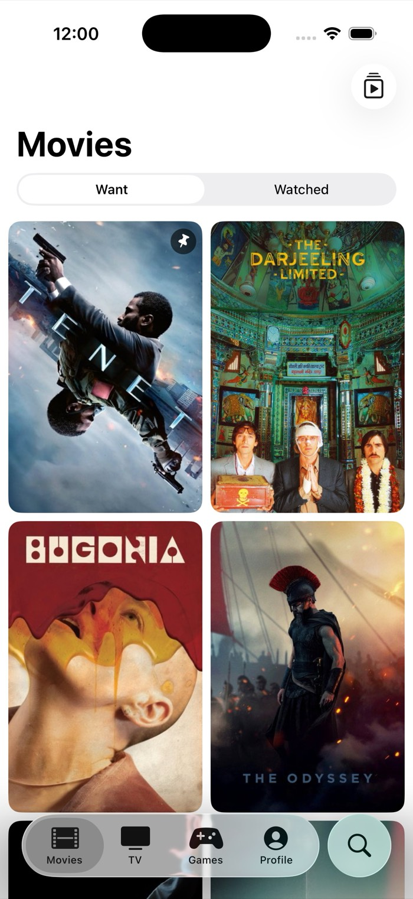
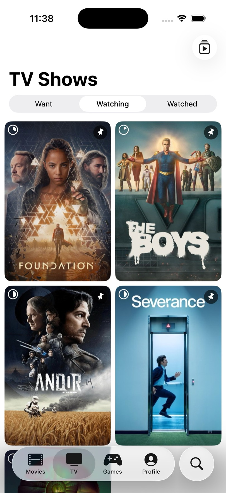
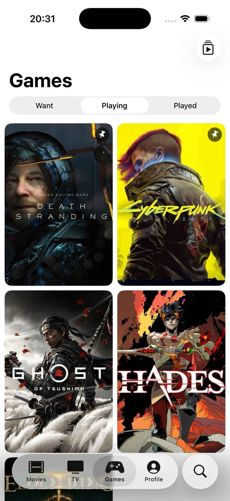

# biinge

Movie, TV and game tracker. Keep separate lists of what you want to start,
what you're in the middle of and what you've finished.

<p align="center">
  <picture>
    <source media="(prefers-color-scheme: dark)" srcset="docs/public/screens/flow-1-library-dark.jpg">
    
  </picture>
  <picture>
    <source media="(prefers-color-scheme: dark)" srcset="docs/public/screens/tv-watching-dark.jpg">
    
  </picture>
  <picture>
    <source media="(prefers-color-scheme: dark)" srcset="docs/public/screens/games-dark.jpg">
    
  </picture>
</p>

## Features

- **Track movies, TV shows and games**: want / watching / watched lists, and want / playing / played for games
- **Episode-level progress**: mark individual episodes and seasons, and the show's state follows
- **Up Next**: aired episodes you haven't watched, plus released movies and games, from the titles you pin
- **Search & trending**: movies, shows and people from TMDB, games from IGDB
- **Jellyfin sync**: played and unplayed marks in Jellyfin carry over (one way, library titles only)
- **Statistics**: watch-time totals and a monthly activity chart
- **Pinning & themes**: pin favorites to the top, with dark, light or system appearance

## Repository layout

Monorepo, one deployable unit per top-level directory: `api/` (Go REST API),
`ios/` (SwiftUI app) and `docs/` (Astro site). The API and the app are
decoupled by the HTTP contract in `api/api/swagger.yaml`; there is no shared
code directory.

## Running the full stack

Bring up the API and its dependencies, then run the app against it.

**1. Start Postgres + Redis and the API** (env setup lives in
[api/README.md](api/README.md#configuration)):

```sh
docker compose up -d database redis                 # Postgres :5432, Redis :6379
make -C api db:migrate                              # apply migrations
cd api && GO_ENV=development go run ./cmd/biinge     # http://localhost:8080
```

Or boot the API with a readiness wait via [fuku](https://github.com/tab/fuku): `fuku up`.

**2. Run the app** (details in [ios/README.md](ios/README.md)):

```sh
make -C ios build     # or open ios/Biinge.xcodeproj in Xcode 26
```

The app targets `http://localhost:8080/api/v1` by default. Library lists are
DB-backed; detail, search, and trending proxy TMDB, so the API needs a real
TMDB token — see [api/README.md](api/README.md#configuration).

## Conventions

Each package owns a `Makefile` with matching targets (`lint`, `test`, `build`/`check`) so CI stays uniform. 
The Go module is rooted inside `api/` (no `go.work`); CI in `.github/workflows/` is scoped per package via `working-directory`.

## License

MIT — see [LICENSE](LICENSE).
